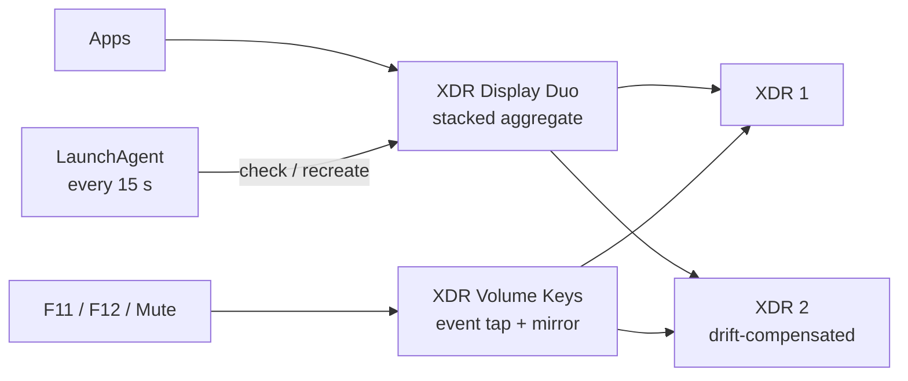

# XDR Display Duo

Use the speakers of **two Apple Studio Display XDRs** as one stereo output on macOS, with the volume keys controlling both displays.

macOS can combine devices into a Multi-Output device, but with two Studio Display XDRs that alone is not enough: depending on the setup, stereo reaches only one display, and F11/F12/Mute change nothing or only one display. XDR Display Duo takes care of three things:

- **Audio routing:** it creates and maintains a stacked aggregate device, *XDR Display Duo*, that sends the same stereo stream to both displays, and repairs it after reconnects.
- **Volume keys:** F11, F12 and Mute change volume and mute on both displays together.
- **Mirror:** a volume or mute change on one display, for example from another app, is copied to the other one immediately.

Everything runs as two per-user LaunchAgents. There is no kernel extension, no audio driver and nothing that runs as root.

## Requirements

- macOS; tested on macOS 26 and 27 (Apple silicon). The APIs used exist since macOS 12, but older versions are untested.
- two Studio Display XDRs connected to the Mac
- Xcode or the Command Line Tools (`xcode-select --install`) for `swiftc`, `make` and `codesign`

## Installation

```bash
git clone https://github.com/ressl/xdr-display-duo.git
cd xdr-display-duo
./install.sh
```

`install.sh` builds everything, detects the two displays, writes the configuration, installs the tools and the helper app, and loads the LaunchAgents. Within 15 seconds the *XDR Display Duo* device appears and becomes the default output.

**Grant Input Monitoring.** The helper reads the volume keys through a global event tap, so macOS asks for *Input Monitoring*. `install.sh` opens the right page in System Settings. Enable **XDR Volume Keys** there. The listener picks up the permission within a minute, after which `~/Library/Logs/xdr-volume-keys.log` shows `listening for F11/F12/Mute`.

Optionally, put the command-line tools on your `PATH`:

```bash
export PATH="$HOME/Library/Application Support/xdr-duo/bin:$PATH"
```

### Configuration

The configuration lives in `~/Library/Application Support/xdr-duo/xdr-duo.conf` (template: [`config/xdr-duo.conf`](config/xdr-duo.conf)). On first install it is filled in automatically when exactly two displays are attached. Otherwise `install.sh` stops and lists the displays it found; enter their UIDs and run it again. You can also list them yourself:

```bash
build/xdr-volume list --xdr
```

| Key | Meaning |
|---|---|
| `XDR1_UID` | CoreAudio UID of the first display's speakers (clock reference) |
| `XDR2_UID` | CoreAudio UID of the second display's speakers (drift-compensated) |
| `AGG_UID`, `AGG_NAME` | UID and name of the aggregate device |
| `TOOLS_DIR` | install location of the command-line tools |

After replacing a display, update its UID and restart the listener. No rebuild is needed.

## Usage

The volume keys work as usual. On the command line:

```bash
xdr-volume get              # volume=56 mute=0 (average of both displays)
xdr-volume set 40           # 0-100, unmutes
xdr-volume up               # one step (1/16), unmutes; likewise: down
xdr-volume mute             # toggle mute on both
xdr-volume raw              # per-display raw values
xdr-volume device 2 getvol  # single display: getvol | setvol 0.0-1.0 | getmute | setmute 0|1
xdr-volume list [--xdr]     # output devices and their UIDs
ca_multioutcheck            # verify the aggregate (PASS/FAIL)
```

## How it works



- The aggregate must be **stacked**, have **no explicit master** device, expose **one stereo buffer**, and use drift compensation on the second display. Other layouts play stereo on one display only. `ca_multioutcheck` verifies all of this, and the repair agent recreates the device when the check fails. A valid device is never touched, so an output you chose deliberately stays selected.
- The helper app runs a listen-only event tap for the media keys, and CoreAudio property listeners on both displays for the mirror. Both run on one serial queue, so a key press and a mirror update never interleave.

Details, design decisions and macOS pitfalls: [docs/ARCHITECTURE.md](docs/ARCHITECTURE.md).

## Troubleshooting

| Symptom | What to do |
|---|---|
| Only one display plays | Run `ca_multioutcheck`. On `FAIL`, run `launchctl kickstart -k gui/$(id -u)/com.ressl.xdr-duo` and make sure *XDR Display Duo* is the selected output. |
| Volume keys do nothing | Check `~/Library/Logs/xdr-volume-keys.log`. If it reports missing Input Monitoring, enable **XDR Volume Keys** in System Settings. |
| Keys stopped working after a rebuild | Input Monitoring is bound to the app's ad-hoc signature, and re-enabling the old entry does **not** help. `./install.sh` resets the entry when the app changed; enable the app again. Manually: `tccutil reset ListenEvent com.ressl.xdr-volume-keys`. |
| Displays have different volumes | Run `xdr-volume raw`. The listener syncs on every change and at start; restart it with `launchctl kickstart -k gui/$(id -u)/com.ressl.xdr-volume-keys`. |

Logs: `~/Library/Logs/xdr-duo.log` (routing) and `~/Library/Logs/xdr-volume-keys.log` (keys and mirror).

## Development

```bash
make            # build the tools into build/
make app        # build/XDR Volume Keys.app, ad-hoc signed
make check      # hardware-free checks: shell syntax, plists, media-key decoder
```

Hardware tests, installed next to the tools, need both displays and an installed setup. `test_multi_output.sh` is read-only; `test_xdr_volume.sh` changes the real volume and restores it afterwards.

## Uninstall

```bash
./uninstall.sh            # keeps the configuration
./uninstall.sh --purge    # removes it too
```

Afterwards pick a regular output in System Settings → Sound, and delete *XDR Display Duo* in Audio MIDI Setup if you no longer need it.

## Documentation

- [docs/ARCHITECTURE.md](docs/ARCHITECTURE.md): architecture, concurrency model, TCC and CoreAudio pitfalls
- [docs/BETRIEB.md](docs/BETRIEB.md): detailed operations manual (German)

## License

[GPL-3.0](LICENSE). Not affiliated with or endorsed by Apple. *Studio Display* is a trademark of Apple Inc.
