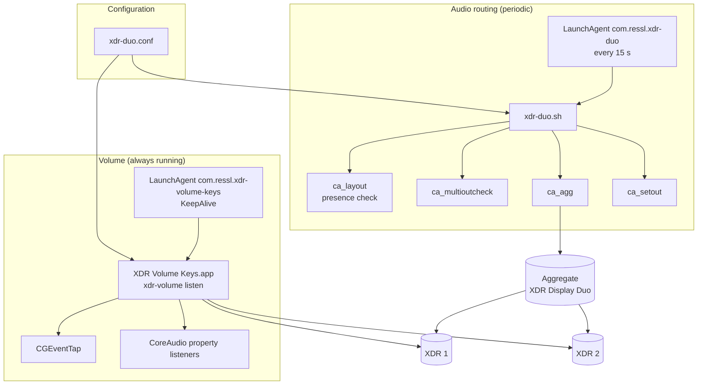
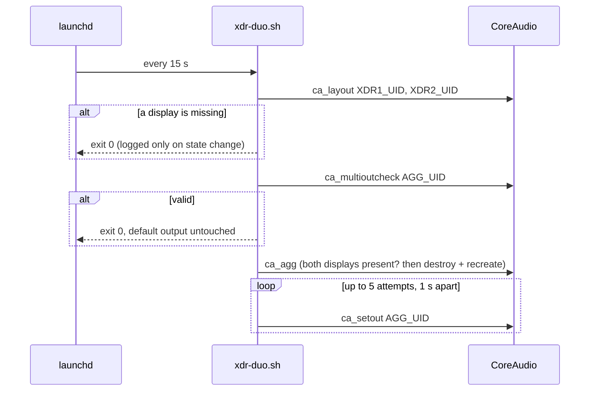
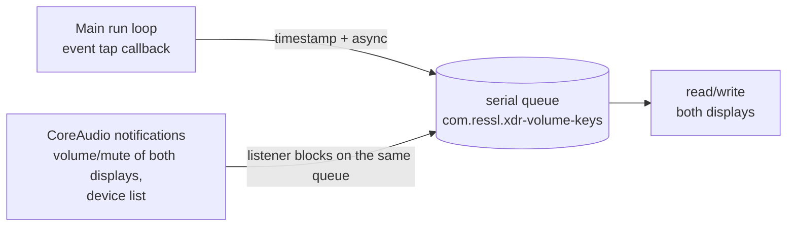

# Architecture and developer notes

Companion to the [README](../README.md) (installation and usage) and the German operations manual [BETRIEB.md](BETRIEB.md). This document explains **why** XDR Display Duo is built the way it is, how the parts interact, and which macOS quirks to keep in mind when changing it.

## Overview



Two independent layers:

| Layer | Job | Triggered by | State |
|---|---|---|---|
| Audio routing | provide the aggregate device with the correct composition | launchd, every 15 s | none (apart from log de-duplication) |
| Volume | apply media keys to both displays, mirror volume and mute | CGEventTap and CoreAudio notifications | in memory only |

## Audio routing

### Why a stacked aggregate without a master

| Variant | Result |
|---|---|
| aggregate with separate channels (4 or 16 channels) | stereo apps only feed the first channel pair: only XDR 1 plays |
| stacked **with** an explicit `master` | also only one display |
| stacked **without** `master`, XDR 2 drift-compensated | both displays get the same stereo stream |

"Stacked" is what Audio MIDI Setup creates as a *Multi-Output Device*: one shared stereo buffer, sent to every subdevice. XDR 1 is the clock reference; XDR 2 follows through drift compensation (quality `0x60`, `kAudioAggregateDriftCompensationHighQuality`).

These settings are defined once, in `DuoComposition` (`src/common/CoreAudio.swift`): `ca_agg` builds the composition from them and `ca_multioutcheck` checks against them. The composition keys (`stacked`, `subdevices`, `uid`, `drift`, `drift quality`) are header macros that Swift does not import, so they appear as string literals.

### Repair flow



Design decisions:

- **A valid aggregate is never touched.** If the user deliberately picks another output, it stays. Only a newly created aggregate becomes the default output.
- **Hence the `ca_setout` retry:** a freshly created aggregate does not always accept becoming the default output right away, and the next run would see a valid aggregate and deliberately leave the default alone.
- **`ca_agg` checks before destroying** that both displays are present; otherwise no aggregate would be left at all.
- **Presence check via CoreAudio, not `system_profiler`:** faster, and bound to the configured UIDs rather than to "any two XDR displays".
- **Log de-duplication:** the steady state is stored in `~/Library/Caches/xdr-duo.status` and logged only when it changes.

### Verified invariants

`ca_multioutcheck` reports `PASS` only if all of these hold:

| Check | Source |
|---|---|
| `stacked = 1` | `kAudioAggregateDevicePropertyComposition` |
| no `master` | composition |
| 1 buffer, 2 channels | `kAudioDevicePropertyStreamConfiguration` (output) |
| active subdevices are exactly `XDR1_UID` and `XDR2_UID` | `kAudioAggregateDevicePropertyActiveSubDeviceList` → `kAudioDevicePropertyDeviceUID` |
| XDR 1 `drift = 0`, XDR 2 `drift = 1` with quality `0x60` | composition, `subdevices[]` |

## Volume: listener and mirror

### Why a helper is needed

With *XDR Display Duo* as the default output, the macOS volume keys have no effect on the displays: without the helper, F11/F12 do nothing. The helper therefore reads the keys itself and writes volume and mute directly to both physical devices (output scope, main element).

### Concurrency model



Every access to the displays goes through **one** serial queue, so key presses and the mirror cannot overwrite each other halfway. That interleaving was the root cause of a bug in version 1, where a 2-second polling mirror could roll back a key press.

### Media-key handling

1. The listen-only tap receives `systemDefined` events (type 14). Only subtype 8 (`NX_SUBTYPE_AUX_CONTROL_BUTTONS`) and key-down (`0x0a` in bits 8–15 of `data1`) are used; the key type is in the upper 16 bits: 0 = up, 1 = down, 7 = mute.
2. The callback records the time (for the mirror's quiet window) and queues the action.
3. On the queue: read the raw values. A target from rapid preceding presses stays valid for 1.5 s; if both displays agree, their value is used instead.
4. Wait 80 ms, so that any native single-device change lands first and the helper has the last word.
5. Write the target to both displays (up/down also unmutes).

If macOS disables the tap (`tapDisabledByTimeout`, `tapDisabledByUserInput`), the callback re-enables it immediately. Otherwise the process would keep running without receiving keys, and `KeepAlive` would never step in.

### Mirror

- Listeners for `kAudioDevicePropertyVolumeScalar` and `kAudioDevicePropertyMute` on both displays, plus `kAudioHardwarePropertyDevices` on the system object, because device IDs change when a display is unplugged and reattached.
- A notification triggers a read of the **current** values of both displays rather than trusting the notification. If the other display differs (volume by at least 1 percentage point, or mute), the value of the display that changed is copied. The helper's own writes also notify, but they resolve to no-ops because the values already match.
- At start and after every device-list change, the listeners are re-bound and the displays are reconciled with XDR 1 as the reference. The permanent divergence that the old poller allowed can no longer happen.
- **Quiet window:** for 0.5 s after a key press the mirror copies nothing and re-checks afterwards. Otherwise it could mirror a native single-device change before the helper runs; for mute, the helper would then toggle the state straight back.

### Constants

| Constant | Value | Purpose |
|---|---|---|
| `volumeStep` | 1/16 | step per key press (6.25 percentage points) |
| `targetCacheLifetime` | 1.5 s | how long the target survives rapid key presses |
| `keyQuietPeriod` | 0.5 s | mirror quiet window after a key press |
| `syncTolerance` | 0.01 | difference from which displays count as out of sync; covers device quantization |
| write delay | 80 ms | lets a native change land first |

## Input Monitoring (TCC)

The event tap needs the **Input Monitoring** permission (`ListenEvent`). Lessons from getting it running:

- **The grant is bound to the signature.** The app is ad-hoc signed, so TCC identifies it by its code hash, and every changed binary gets a new hash. The old entry in System Settings then belongs to the old signature, and toggling it off and on does **not** help. It must be removed with `tccutil reset ListenEvent com.ressl.xdr-volume-keys` and granted again. `install.sh` does this automatically when the code hash changed.
- **macOS evaluates the grant once per process.** A running process does not notice a grant given later. Without permission, the listener therefore exits after 60 s and launchd restarts it.
- **`--request-permission` only requests and exits.** Otherwise the process started by `open -n` would stay alive as a second listener, and every key press would be applied twice.
- Possible improvement: a self-signed code-signing identity in the keychain. The designated requirement would then consist of bundle ID and certificate instead of the code hash, and the grant would survive rebuilds.

## CoreAudio pitfalls

| Observation | Consequence |
|---|---|
| `kAudioHardwarePropertyTranslateUIDToDevice` takes a pointer to a `CFString` as qualifier | The string must stay alive during the call. `audioDevice(forUID:)` keeps it in a local variable; `unsafeBitCast` of a temporary bridged string is undefined behaviour. |
| An aggregate's device ID is process-local: `ca_agg` reported `id=147` while other processes saw the same device as `id=108` | Always address devices by UID, never pass IDs between processes. |
| Private aggregates (`"private": true`) are visible only to the process that created them | To test `ca_multioutcheck`, use a short-lived public test aggregate with its own UID. |
| The composition reports per subdevice `drift`, `drift quality`, `channels-out`, `latency-out` and more | Drift settings can be verified. |
| Written volume scalars are quantized (`0.70` → `0.6966`) | Always compare with a tolerance. |
| The physical displays report 8 output channels; the aggregate must report 2 | Check the layout on the aggregate, not on the displays. |

## Build and source layout

```text
src/common/CoreAudio.swift      shared code (configuration, UIDs, volume/mute, composition)
src/<tool>/main.swift           one tool each, with top-level code
```

Once several files are compiled together, Swift only allows top-level code in `main.swift`, hence one directory per tool. The `Makefile` builds each tool as `swiftc src/common/*.swift src/<tool>/main.swift` with its own module name (dashes replaced). `make app` wraps `xdr-volume` with `app/Info.plist` and signs it ad hoc.

The configuration file `xdr-duo.conf` is shell syntax on purpose: the scripts source it, and `DuoConfig` in Swift reads the same `KEY="value"` lines literally. Only `TOOLS_DIR` may use shell expansion, because Swift does not read that key.

## Test strategy

| Test | Hardware | Changes state | Purpose |
|---|---|---|---|
| `make check` (also in CI) | no | no | shell syntax, plists, media-key decoder including a foreign subtype |
| `test_multi_output.sh` | yes | no | aggregate invariants |
| `test_xdr_volume.sh` | yes | yes, restores the previous values | set/up/down/mute on both displays |
| mirror check ([BETRIEB.md](BETRIEB.md#mirror)) | yes | yes | a single-display change is copied |
| physical key test | yes | yes | end to end, including Input Monitoring |

## Validation

Version 1 (macOS 26):

- structure check `PASS`
- acoustic check with the Mac's built-in microphone, 330 Hz band: both displays muted `0`, only XDR 1 `33.85`, only XDR 2 `56.37` (relative values, not calibrated dB; what matters is that each display produced a signal on its own and the muted baseline was zero)
- synthetic F12 event through the installed LaunchAgent: both displays reported the same scalar afterwards

Version 2 (macOS 27):

- `test_multi_output.sh`: `PASS … members=ok drift=ok`; a test aggregate without drift compensation on XDR 2 correctly failed with `drift=wrong`
- `test_xdr_volume.sh`: `PASS`
- mirror: single-display volume and mute changes were copied within 300 ms, and diverged displays were reconciled at start
- physical keys: F12 in even steps (19 → 25 → 31 → 38 %), mute on and off, both displays in sync

## Known limitations

- Two writes per change, no transaction; a failure between them is corrected by the mirror.
- The 80 ms delay and the 0.5 s quiet window are empirical values.
- Ad-hoc signature: after every change to the app, Input Monitoring must be granted again (see above).
- Exactly two configured displays; more are not supported.

## Version history

| Version | Changes |
|---|---|
| 1 | stacked aggregate, repair agent, media-key helper, 2-second polling mirror with state file |
| 2 | central configuration, event-driven mirror in the helper app, stricter invariant check, tap re-enabling, subtype check, default-output retry, `Makefile`/`install.sh`/`uninstall.sh`, TCC handling, `xdr-volume list` |
