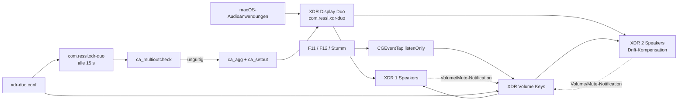

# XDR Display Duo – Betriebshandbuch

Ausführliche Betriebs-, Wiederherstellungs- und Wartungsdokumentation (Deutsch). Einstieg und Installation: [README](../README.md). Aufbau, Designentscheidungen und macOS-Eigenheiten: [ARCHITECTURE.md](ARCHITECTURE.md).

Die Befehle in diesem Handbuch setzen voraus, dass das Werkzeugverzeichnis im `PATH` liegt:

```bash
. "$HOME/Library/Application Support/xdr-duo/xdr-duo.conf"   # setzt TOOLS_DIR, AGG_UID, XDR1_UID, XDR2_UID
export PATH="$TOOLS_DIR:$PATH"
```

Die physischen Lautsprecher werden über ihre CoreAudio-UIDs identifiziert, die ausschließlich in der [Konfiguration](#konfiguration) stehen. `xdr-volume list --xdr` zeigt die UIDs der angeschlossenen Displays.

## Ziel und Randbedingungen

Ein gewöhnliches Aggregate Device mit separaten Kanälen löst das Problem nicht: Stereo-Programme beschicken dann nur das erste Kanalpaar und damit nur ein Display. Auch ein gestapeltes Gerät mit explizitem Master-Subdevice führte in dieser Installation dazu, dass Stereo nur auf einem Display ankam.

Die funktionierende CoreAudio-Komposition hat daher exakt diese Invarianten:

1. `stacked = true`
2. **kein** expliziter `master`-Eintrag
3. ein gemeinsamer Stereo-Buffer
4. insgesamt zwei Ausgabekanäle
5. genau die beiden konfigurierten XDR-Subdevices aktiv
6. XDR 1 ohne Drift-Kompensation
7. XDR 2 mit Drift-Kompensation in hoher Qualität

Diese Form verteilt denselben Stereo-Stream auf beide Displays. `ca_multioutcheck` prüft alle sieben Invarianten und liefert nur bei einer gültigen Komposition Exit-Code 0. `ca_agg` und `ca_multioutcheck` beziehen die Drift-Vorgaben aus derselben Quelle (`DuoComposition` in `src/common/CoreAudio.swift`).

## Architektur



Es gibt zwei voneinander getrennte Betriebsfunktionen.

### 1. Aggregate-Reparatur

`com.ressl.xdr-duo` startet alle 15 Sekunden `~/Library/Application Scripts/xdr-duo.sh` (Prozesstyp `Background`).

Ablauf:

1. `ca_layout` prüft über CoreAudio, ob **beide konfigurierten** UIDs vorhanden sind. Fehlt eine, endet der Lauf ohne Änderung.
2. `ca_multioutcheck` prüft das vorhandene Aggregate Device.
3. Ist es gültig, bleibt es unverändert. Insbesondere wird eine vom Benutzer bewusst gewählte andere Standardausgabe nicht überschrieben.
4. Fehlt es oder ist es ungültig, zerstört `ca_agg` die alte Instanz und erstellt `XDR Display Duo` neu. `ca_setout` setzt es danach als Standardausgabe und versucht das bis zu fünfmal im Sekundenabstand, weil ein frisch erstelltes Aggregate die Auswahl nicht immer sofort annimmt. Ein späterer Lauf würde das gültige Aggregate bewusst nicht mehr als Standard setzen.

Ins Log wird ein Ruhezustand nur geschrieben, wenn er sich gegenüber dem vorherigen Lauf ändert (Vergleichswert in `~/Library/Caches/xdr-duo.status`).

`ca_agg` ist beim direkten manuellen Aufruf **nicht** rein prüfend: Eine vorhandene Instanz wird zuerst zerstört und anschließend neu erstellt. Fehlt eines der beiden Displays, bricht `ca_agg` ab, **bevor** es etwas zerstört.

### 2. Media Keys und Volume-Mirror

Die menülose App `~/Applications/XDR Volume Keys.app` läuft über `com.ressl.xdr-volume-keys` dauerhaft in der Aqua-Sitzung (`xdr-volume listen`). Sie übernimmt zwei Aufgaben auf **einer** seriellen Queue, sodass sie sich nie gegenseitig halb überschreiben:

**Media Keys.** Ein `listenOnly`-CGEventTap für `systemDefined`-Events wertet nur Subtyp 8 (Aux Control Buttons) und nur Key-down-Ereignisse aus:

| Media-Key-Typ | Aktion |
|---:|---|
| `0` | Lauter |
| `1` | Leiser |
| `7` | Stumm umschalten |

Key-up-Ereignisse, andere Subtypen und andere Media Keys werden ignoriert. Der EventTap unterdrückt das ursprüngliche macOS-Ereignis nicht. Nach 80 ms schreibt der Helper deshalb den berechneten Zielwert direkt auf beide physischen XDR-Geräte und gewinnt damit gegenüber dem nativen Einzelgerätepfad. Deaktiviert macOS den Tap (Timeout oder sichere Eingabe), schaltet der Helper ihn sofort wieder ein und protokolliert das.

- Schrittweite Lauter/Leiser: `1/16` des CoreAudio-Skalars, also 6,25 Prozentpunkte
- schnell aufeinanderfolgende Tastendrücke verwenden einen zwischengespeicherten Zielwert; er verfällt nach 1,5 s
- Lauter und Leiser heben Stumm auf
- Stumm schaltet beide Geräte gemeinsam um
- ohne gültigen Zielwert verwendet Lauter bei abweichenden Geräten den kleineren und Leiser den größeren Rohwert als sichere Basis
- die beiden CoreAudio-Schreibvorgänge erfolgen nacheinander; es gibt keine hardwareseitige Transaktion

**Mirror.** Der Helper registriert CoreAudio-Property-Listener für Volume und Mute beider Displays. Ändert sich ein Wert auf einem Display (z. B. durch ein anderes Programm), wird er auf das andere kopiert; Unterschiede unter 1 Prozentpunkt gelten als synchron. Beim Start und nach jedem An- oder Abstecken (Änderung der Geräteliste) werden die Listener neu gebunden und abweichende Werte mit XDR 1 als Referenz angeglichen. Für 0,5 s nach einem Media Key hält sich der Mirror zurück und prüft danach erneut, damit er die native Einzelgeräteänderung nicht vor dem Helper überträgt und so etwa einen Stumm-Tastendruck aufhebt.

Fehlt die Eingabeüberwachung, läuft der Mirror trotzdem. macOS wertet die Freigabe nur einmal pro Prozess aus; der Helper beendet sich deshalb nach 60 Sekunden, und launchd startet ihn neu, sodass eine inzwischen erteilte Freigabe greift.

Die App ist ad hoc signiert und verwendet die Bundle-ID `com.ressl.xdr-volume-keys`. Sie benötigt macOS **Datenschutz & Sicherheit → Eingabeüberwachung**.

## Konfiguration

Einzige Stelle für Display-UIDs, Aggregate-UID/-Name und Werkzeugverzeichnis:

```text
~/Library/Application Support/xdr-duo/xdr-duo.conf
```

Vorlage im Repository: `config/xdr-duo.conf`. Die Shell-Skripte sourcen die Datei, die Swift-Werkzeuge lesen `XDR1_UID`, `XDR2_UID`, `AGG_UID` und `AGG_NAME` wörtlich (keine Shell-Expansion in diesen Werten). Für Tests oder Diagnose kann mit `XDR_DUO_CONFIG=/pfad/zur/datei` eine andere Konfiguration verwendet werden.

## Dateien und Verantwortlichkeiten

### Repository

| Pfad | Zweck |
|---|---|
| `README.md` | Einstieg, Installation, Kurzreferenz (Englisch) |
| `docs/BETRIEB.md` | dieses Handbuch |
| `docs/ARCHITECTURE.md` | Architektur und Entwicklerdokumentation (Englisch) |
| `uninstall.sh` | entfernt Agents, App und Werkzeuge; `--purge` auch die Konfiguration |
| `Makefile` | baut Werkzeuge (`make`), App (`make app`) und führt Hardware-freie Checks aus (`make check`) |
| `install.sh` | baut, installiert und lädt die LaunchAgents neu |
| `config/xdr-duo.conf` | Konfigurationsvorlage |
| `app/Info.plist` | Bundle-Identität der App |
| `src/common/CoreAudio.swift` | gemeinsamer Code: Konfiguration, UID-Auflösung, Volume/Mute, Kompositionsvorgaben |
| `src/xdr-volume/` | CLI, Listener und Mirror; Quelle von `xdr-volume` und `XDR Volume Keys` |
| `src/ca_agg/` | erstellt das gestapelte Multi-Output-Gerät |
| `src/ca_multioutcheck/` | prüft die Aggregate-Invarianten |
| `src/ca_setout/` | setzt ein Gerät anhand seiner UID als Standardausgabe |
| `src/ca_layout/` | zeigt Device-ID und Anzahl der Ausgabekanäle; Exit 1, wenn die UID fehlt |
| `src/ca_chanplay/` | optionales Diagnosewerkzeug: 2,5-s-Testton auf einem Kanalpaar |
| `scripts/xdr-duo.sh` | Aggregate-Reparatur |
| `scripts/test_*.sh` | Regressionstests (siehe [Tests](#tests)) |
| `launchd/*.plist` | LaunchAgent-Vorlagen; `install.sh` ersetzt `__HOME__` |

Einzelgerätezugriffe bietet `xdr-volume device 1|2 getvol|setvol|getmute|setmute`.

### Laufzeitdateien

| Pfad | Zweck |
|---|---|
| `$TOOLS_DIR` (Standard `~/Library/Application Support/xdr-duo/bin`) | Binaries und Testskripte |
| `~/Library/Application Support/xdr-duo/xdr-duo.conf` | Konfiguration |
| `~/Library/Application Scripts/xdr-duo.sh` | erkennt und repariert das Aggregate Device |
| `~/Library/LaunchAgents/com.ressl.xdr-duo.plist` | 15-Sekunden-Reparatur-Agent |
| `~/Library/LaunchAgents/com.ressl.xdr-volume-keys.plist` | dauerhaft laufender Listener und Mirror |
| `~/Applications/XDR Volume Keys.app` | signierte, menülose Helper-App |

### Logs

| Log | Inhalt |
|---|---|
| `~/Library/Logs/xdr-duo.log` | Zustandswechsel der Aggregate-Prüfung, Reparatur und Default-Output-Setzung |
| `~/Library/Logs/xdr-volume-keys.log` | Listener-Start, Media Keys, gespiegelte Änderungen, Tap-Reaktivierung, Fehler |

## Installation und Aktualisierung

Voraussetzungen: Apple Command Line Tools mit `swiftc`, beide Displays angeschlossen.

```bash
./install.sh
```

Das Skript:

1. baut alle Werkzeuge und die App (`make all app check`), signiert die App ad hoc,
2. legt beim ersten Mal die Konfiguration an und trägt die UIDs ein, wenn genau zwei Displays angeschlossen sind; sonst bricht es mit einer Liste der gefundenen UIDs ab (eine vorhandene Konfiguration bleibt erhalten),
3. kopiert Binaries und Tests nach `$TOOLS_DIR`, `xdr-duo.sh` nach `~/Library/Application Scripts`, die App nach `~/Applications`,
4. entfernt Reste von Version 1 (Polling-Mirror `com.ressl.xdr-duo-vol`, `xdr-duo-vol.sh`, Zustandsdatei),
5. schreibt die LaunchAgents mit dem eigenen `$HOME` und lädt sie neu.

Hat sich die App geändert, hat sie eine neue Ad-hoc-Signatur, an die die bisherige Freigabe der Eingabeüberwachung nicht mehr passt. `install.sh` setzt den Eintrag dann per `tccutil reset` zurück, fordert die Freigabe neu an und öffnet die Einstellungsseite; **XDR Volume Keys** dort aktivieren. Bei unveränderter App bleibt die Freigabe bestehen.

Nur bauen, ohne zu installieren:

```bash
make            # Werkzeuge nach build/
make app        # build/XDR Volume Keys.app
make check      # Syntax, Plists, Decoder-Test
```

## Bedienung

### Gemeinsame Lautstärke lesen

```bash
xdr-volume get
```

Ausgabe:

```text
volume=70 mute=0
```

`volume` ist der gerundete Mittelwert beider physischen Skalare. `mute=1` wird nur ausgegeben, wenn beide Geräte stumm sind. Für eine Desynchronisationsdiagnose die Rohwerte lesen:

```bash
xdr-volume raw
```

```text
xdr1 volume=0.6966 mute=0
xdr2 volume=0.6966 mute=0
```

Das ist kein Lautheitswert in dB. Die Geräte quantisieren geschriebene Skalare; `0.6966` statt exakt `0.7000` ist normal.

### Gemeinsame Lautstärke setzen

```bash
xdr-volume set 70
xdr-volume up
xdr-volume down
xdr-volume mute
```

- `set` akzeptiert nur Ganzzahlen von 0 bis 100.
- `set`, `up` und `down` heben Stumm auf.
- `mute` schaltet den gemeinsamen Mute-Zustand um.
- Alle Befehle adressieren die beiden konfigurierten physischen UIDs, unabhängig von der aktuell gewählten macOS-Standardausgabe.

### Einzelnes Display

```bash
xdr-volume device 2 getvol
xdr-volume device 2 setvol 0.5
xdr-volume device 2 getmute
xdr-volume device 2 setmute 0
```

Bei laufendem Listener überträgt der Mirror eine solche Einzeländerung sofort auf das andere Display.

### Aggregate Device prüfen

```bash
ca_multioutcheck
```

Erwartet:

```text
PASS: stacked=1 master=none buffers=1 channels=2 activeSubdevices=2 members=ok drift=ok
```

Zusätzlicher Layout-Check:

```bash
ca_layout "$AGG_UID"
```

Die Ausgabe muss `output channels: 2` enthalten.

### Aggregate Device manuell reparieren

Bevorzugt den idempotenten Repair-Agent auslösen:

```bash
launchctl kickstart -k gui/$(id -u)/com.ressl.xdr-duo
```

Direkte Neuerstellung nur bei gezielter Reparatur:

```bash
ca_agg
ca_setout "$AGG_UID"
```

Der direkte Aufruf von `ca_agg` unterbricht die Ausgabe kurz, weil die vorhandene Instanz zuerst entfernt wird.

### Gültiges Aggregate wieder als Standard setzen

Der Repair-Agent respektiert eine bewusst gewählte andere Standardausgabe, solange das Aggregate gültig ist. Daher bei Bedarf explizit setzen:

```bash
ca_setout "$AGG_UID"
```

Alternativ in **Systemeinstellungen → Ton → Ausgabe** `XDR Display Duo` wählen.

## LaunchAgents verwalten

Launchd-Domain dieser Benutzerinstallation: `gui/$(id -u)`

### Status prüfen

```bash
launchctl print gui/$(id -u)/com.ressl.xdr-duo
launchctl print gui/$(id -u)/com.ressl.xdr-volume-keys
```

Beim periodischen Repair-Agent ist `state = not running` zwischen zwei Läufen normal. Maßgeblich sind `last exit code = 0` und das konfigurierte `run interval`. Der Listener muss dauerhaft `state = running` melden.

### Neu starten

```bash
launchctl kickstart -k gui/$(id -u)/com.ressl.xdr-duo
launchctl kickstart -k gui/$(id -u)/com.ressl.xdr-volume-keys
```

### Aus Sitzung entfernen und erneut laden

```bash
launchctl bootout gui/$(id -u)/com.ressl.xdr-volume-keys
launchctl bootstrap gui/$(id -u) "$HOME/Library/LaunchAgents/com.ressl.xdr-volume-keys.plist"
```

`bootstrap` ist für einen noch nicht geladenen Agent gedacht. Bei einem bereits geladenen Agent stattdessen `kickstart -k` verwenden.

## Eingabeüberwachung

Die App benötigt Input-Monitoring-Zugriff, weil Media Keys über einen globalen CGEventTap gelesen werden.

Permission anfordern (fragt nur an und beendet sich; es startet keinen zweiten Listener):

```bash
open -n -a "$HOME/Applications/XDR Volume Keys.app" --args listen --request-permission
```

Einstellungsseite öffnen:

```bash
open "x-apple.systempreferences:com.apple.preference.security?Privacy_ListenEvent"
```

Dort muss **XDR Volume Keys** aktiviert sein. Ein Listener ohne Freigabe startet sich spätestens nach 60 Sekunden neu und übernimmt sie dann (Log: `listening for F11/F12/Mute`). Sofort übernehmen:

```bash
launchctl kickstart -k gui/$(id -u)/com.ressl.xdr-volume-keys
```

Nach einem Neubau (neue Ad-hoc-Signatur) hilft Aus- und Einschalten des alten Eintrags **nicht**; er gehört zur alten Signatur. Falls das Log weiterhin `Input Monitoring permission is required` zeigt:

1. Eintrag entfernen: `tccutil reset ListenEvent com.ressl.xdr-volume-keys`
2. Freigabe mit dem `--request-permission`-Befehl oben neu anfordern und **XDR Volume Keys** aktivieren.
3. Den LaunchAgent neu starten.

## Tests

Die Tests lesen die installierte Konfiguration; `XDR_DUO_CONFIG` und `XDR_VOLUME` überschreiben Konfiguration bzw. Binary.

### Hardware-frei

```bash
make check
```

Enthält den Decoder-Test (`PASS: media-key data1 decoding`) für Lauter, Leiser, Stumm, ignorierte Key-up-Ereignisse, einen fremden Media-Key-Typ und einen fremden Event-Subtyp.

### Aggregate-Struktur

Read-only:

```bash
test_multi_output.sh
```

Erwartetes Ende:

```text
PASS: stacked=1 master=none buffers=1 channels=2 activeSubdevices=2 members=ok drift=ok
```

### Gemeinsame Lautstärke und Stumm

**Verändert die reale Lautstärke beider Displays.** Der Test setzt 50 %, erhöht und senkt einmal und schaltet Stumm zweimal. Am Ende stellt er die vorherige Lautstärke und den vorherigen Stumm-Zustand wieder her.

```bash
test_xdr_volume.sh
```

Erwartet:

```text
PASS: dual-display set/up/down/mute commands
```

### Mirror

Bei laufendem Listener:

```bash
xdr-volume device 2 setvol 0.3
sleep 0.2
xdr-volume raw
```

Beide Zeilen müssen denselben Wert zeigen; `xdr-volume-keys.log` enthält `mirror: volume=30 xdr2 -> xdr1`.

### Physische Tasten

Manueller End-to-End-Test:

1. Audio über `XDR Display Duo` abspielen.
2. F12/Lauter drücken: beide Displays werden lauter.
3. F11/Leiser drücken: beide Displays werden leiser.
4. Stumm drücken: beide Displays verstummen.
5. Stumm erneut drücken: beide Displays werden wieder hörbar.
6. `launchctl print gui/$(id -u)/com.ressl.xdr-volume-keys` muss weiterhin `state = running` zeigen.

## Fehlerdiagnose

### Nur ein Display gibt Ton aus

1. Aggregate-Invarianten prüfen: `ca_multioutcheck`
2. Bei `FAIL` den Repair-Agent auslösen: `launchctl kickstart -k gui/$(id -u)/com.ressl.xdr-duo`
3. Erneut prüfen.
4. Sicherstellen, dass `XDR Display Duo` die Standardausgabe ist.
5. `~/Library/Logs/xdr-duo.log` auf fehlende Displays oder CoreAudio-Fehler prüfen.

Ein 16-Kanal-Layout, ein explizites Master-Subdevice, falsche Subdevices (`members=wrong`) oder falsche Drift-Einstellungen (`drift=wrong`) sind für diesen Anwendungsfall ungültig.

### F11/F12/Stumm reagieren nicht

1. Listener-Status prüfen: `launchctl print gui/$(id -u)/com.ressl.xdr-volume-keys`
2. `~/Library/Logs/xdr-volume-keys.log` prüfen. Steht dort `Input Monitoring permission is required`, die Freigabe wie oben beschrieben erneuern.
3. Neu starten: `launchctl kickstart -k gui/$(id -u)/com.ressl.xdr-volume-keys`
4. Signatur prüfen: `codesign --verify --strict --verbose=2 "$HOME/Applications/XDR Volume Keys.app"`

### Lautstärken laufen auseinander

```bash
xdr-volume raw
```

Bei laufendem Listener gleicht der Mirror jede Änderung sofort an. Bleiben die Werte verschieden, im Log nach `mirror:`-Fehlern suchen und den Listener neu starten; beim Start gleicht er mit XDR 1 als Referenz an. Einen gemeinsamen Wert setzt `xdr-volume set 70`.

### Nach Ab- und Anstecken fehlt ein Display

- Beide konfigurierten UIDs müssen in CoreAudio vorhanden sein (`ca_layout "<UID>"` liefert Exit 0).
- Der Repair-Agent wartet auf beide Geräte und prüft danach innerhalb von spätestens 15 Sekunden erneut.
- Ist das Aggregate nach dem Wiederverbinden ungültig, wird es neu erstellt und als Standard gesetzt.
- Der Mirror bindet sich bei jeder Änderung der Geräteliste selbst neu.
- Bei sofortigem Bedarf den Repair-Agent manuell auslösen.

### Der Key-Agent startet immer wieder neu

`KeepAlive=true` und `ThrottleInterval=10` bedeuten, dass launchd einen beendeten Listener erneut startet. Fehlende Eingabeüberwachung beendet den Listener nicht mehr; wiederholte Starts deuten auf eine fehlende oder ungültige Konfiguration oder einen Absturz hin. Maßgeblich ist `xdr-volume-keys.log`.

## Display austauschen

1. Neue CoreAudio-UID bestimmen: `xdr-volume list --xdr`
2. `XDR1_UID` bzw. `XDR2_UID` in `~/Library/Application Support/xdr-duo/xdr-duo.conf` ersetzen.
3. Listener neu starten: `launchctl kickstart -k gui/$(id -u)/com.ressl.xdr-volume-keys`
4. Aggregate neu erstellen: `ca_agg && ca_setout "$AGG_UID"`
5. Alle Regressionstests ausführen.
6. Physische Tasten und echte Audioausgabe auf beiden Displays prüfen.

Ein Neubau ist nicht nötig; alle Komponenten lesen dieselbe Konfiguration.

## Deaktivieren und Entfernen

### Nur Media Keys und Mirror deaktivieren

```bash
launchctl bootout gui/$(id -u)/com.ressl.xdr-volume-keys
```

Das Aggregate Device bleibt dabei aktiv.

### Gesamte Automatik deaktivieren

```bash
launchctl bootout gui/$(id -u)/com.ressl.xdr-volume-keys
launchctl bootout gui/$(id -u)/com.ressl.xdr-duo
```

Danach in den Systemeinstellungen eine normale physische Ausgabe wählen.

### Vollständig entfernen

```bash
./uninstall.sh            # Konfiguration bleibt erhalten
./uninstall.sh --purge    # entfernt auch die Konfiguration
```

Das Skript entfernt Agents, Plists, `xdr-duo.sh`, Helper-App, Werkzeuge und den Eintrag in der Eingabeüberwachung. Das Aggregate Device *XDR Display Duo* bei Bedarf in der Audio-MIDI-Konfiguration löschen.

## Wartungsgrundsätze

- Die Aggregate-Invarianten nicht „vereinfachen“: insbesondere keinen expliziten Master ergänzen und kein Mehrkanal-Layout erzeugen.
- Vor Änderungen die zwei Ebenen getrennt betrachten: Audio-Routing und Media-Key-Steuerung/Mirror.
- UIDs nur in der Konfiguration ändern, nie im Code.
- Nach Änderungen am Swift-Code `./install.sh` ausführen; es baut CLI und App gemeinsam.
- Nach einem App-Neubau die Eingabeüberwachung prüfen.
- `test_xdr_volume.sh` verändert echte Hardwarewerte; nicht unbemerkt in einen allgemeinen Testlauf aufnehmen.
- Logs und Konfiguration enthalten keine Zugangsdaten.
